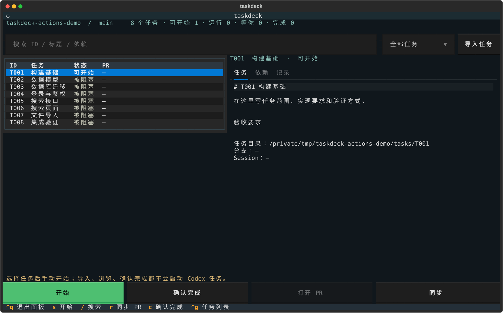

# taskdeck

本地终端任务控制台。一个任务文件夹对应一个 Git worktree、一条分支、一个真实 Codex 会话和一个 PR。

任务全部手动开始。创建任务、浏览、筛选、查看会话、刷新依赖都不会启动模型；满足依赖只会变成「可开始」。多个手动开始的任务可以并行。



## 使用

已安装的命令是 `taskdeck`。在任意 Git 项目或其子目录中执行：

```sh
taskdeck init --base main
taskdeck add T001 "构建基础"
taskdeck add T002 "数据库实现" --depends T001
taskdeck edit T001
taskdeck
```

`init` 默认选远端默认分支，其次选择本地 main/master，最后回退到当前分支；也可以指定 `--base main`。新仓库需至少有一个提交，才可以创建 worktree。初始化会写入 `.taskctl.yaml`、任务目录和 `.gitignore` 中的本机运行目录忽略规则；不会替你提交。

面板支持鼠标按钮和方向键选择任务。`s` 开始，`/` 搜索，`r` 同步基线与 PR，`Ctrl+Q` 退出面板。任务已有 session 时，右侧 tab 列表第一位显示「Codex」，点击该 tab 进入会话；未开始的任务隐藏该 tab。会话内是本机 Codex CLI 的原生终端界面，Enter、Esc、方向键、斜杠命令、粘贴和审批由 Codex 处理：Enter 发送，工作时 Esc 中断当前轮次。`Ctrl+G` 将焦点移回任务列表，方便切换任务；也可直接点击其他 tab。输入框/编辑器获得焦点时可以正常输入文字。

操作区只有「开始」「确认完成」「打开 PR」「同步」四个按钮，使用一行布局，80 列 × 24 行终端也能完整显示按钮；更宽终端便于查看长任务标题。新增任务可运行 `taskdeck add`，查看 Git 改动可运行 `taskdeck diff`。

已有 `docs/tasks/Txxx-*.md` 的项目，可点击面板「导入任务」，或执行：

```sh
taskdeck import docs/tasks --dry-run
taskdeck import docs/tasks
```

导入按一级标题和任务表格提取 ID、标题、依赖、阶段和验收清单，并把完整原文保存在各任务的 `description.md` 中。原文件保持不变，重复导入保留已有任务及用户修改。导入不启动 Codex。

原文档标为「已完成」的任务显示为「待核对」。普通开发任务也可以选择后点击底部「确认完成」，或在任务列表中按 `c`，核对实际交付提交。开发完成与会话状态分别保存：会话运行、等待或空闲时都能确认交付，确认不会中断或关闭会话。代码尚未进入目标基线时显示「已完成，待入基线」，只有入基线后才解除依赖。未选择任务时「开始」按钮禁用，空列表显示导入任务或 `taskdeck add` 提示。

## 任务目录

```text
project/
  .taskctl.yaml
  tasks/
    T001/
      task.yaml
      description.md
      delivery.md              # 在任务分支中生成，随 PR 提交
      .local/                  # Git 忽略
        state.json             # 状态、计划、分支、PR、交付提交
        session.json           # 真实 Codex thread ID
        transcript.json        # 持久化对话和命令结果
        events.jsonl           # 手动开始、调整、中断、失败等事件
        worktree/              # 独立源码工作目录
```

`task.yaml` 例子：

```yaml
id: T002
title: 数据库实现
depends_on: [T001]
acceptance:
  - 数据库初始化成功
  - 数据迁移测试通过
```

只扫描配置任务目录的直接子目录中的 `task.yaml`，以清单 `id` 识别任务，不递归进入 worktree。ID 在仓库内唯一，跨仓库可以重复。重复 ID、缺失依赖、循环依赖和目录越界都会报错。清单和说明可以提交；运行状态、日志和 worktree 保留在本机。

任务文件夹可以改名，ID 保持不变。请先停止该任务再改名；下次手动开始时修复 worktree 指针并保留 session。配置的目标分支属于项目级设置，统一用于依赖门槛和 PR。

项目登记放在 Git 共享管理目录的 `taskdeck/project.json` 下。从项目的子目录或关联 worktree 启动，都会定位同一套任务。换机器或新 clone 后本机 session 状态独立；可以保留清单中的 `completed_commit` 以共享已交付的提交证据。

## 会话和后台服务

执行层是本机 `codex app-server`，通过用户私有的 Unix socket 接入。首页「Codex」tab 在 PTY 中运行真正的 `codex resume --remote unix://... <thread_id>`，连接该任务已有的同一个 thread；会话内容、输入框、菜单和审批由 Codex 自己渲染，面板不再实现额外的对话页面。切换任务保留各自的终端客户端；退出面板只分离客户端，独立服务继续运行。默认沿用已登录的 Codex 模型、沙箱和审批配置，不处理 API key 或 OAuth token。原生接入需要支持 `--remote` 和 Unix socket 的 Codex CLI，本机验证版本为 0.162.1。参见 [官方原生终端接入说明](https://learn.chatgpt.com/docs/app-server#connect-the-cli-terminal-ui)。

后台服务在第一次手动开始/发送或接入已有会话时启动，退出面板后继续运行。只浏览任务不会启动 Codex 服务；打开已有会话只恢复连接，不开始模型轮次。服务重启/断线后可进入原会话继续输入，不自动重跑。

原生会话遵循 Codex 自己的消息排队/调整和快捷键行为。CLI 的 `taskdeck send` 在运行中使用 `turn/steer`，空闲时使用 `turn/start`；`taskdeck stop` 使用 `turn/interrupt`。等收到完成通知后才显示已中断。已产生的文件修改保留。中断轮次不等于清理 Codex 启动的全部后台 shell。

审批和问题直接使用 Codex 原生会话里的交互，面板不另加 JSON 请求弹窗。模型轮次完成只标为「等你继续」，不据此假定测试通过或任务已合并。

Codex tab 的滚轮每次移动 3 行。向上浏览历史时，新输出会继续接收，画面保持在你正在查看的位置；滚回底部或开始键入、粘贴后回到当前会话。终端显示层更新后，按 `Ctrl+Q` 退出并重新运行 `taskdeck` 即可加载，无需停止后台任务服务。

从旧版升级时，已有后台服务仍运行旧代码。先等待运行中的任务结束，再执行 `taskdeck service stop`，然后用 `Ctrl+Q` 退出并重新运行 `taskdeck`。进入原会话时会接入新的本地端点，继续使用原 thread，不会重新创建会话或自动开始任务。

```sh
taskdeck start T001
taskdeck chat T001
taskdeck send T001 "先检查失败的测试，暂缓改动界面"
taskdeck stop T001
taskdeck service status
taskdeck service stop
```

关闭后台服务会断开本项目的执行连接。只想离开面板时用 `Ctrl+Q`。

## 依赖和 PR

任务启动前刷新目标分支、检查依赖交付提交确实在基线中，再检查 worktree 是否包含这些提交。不会只凭状态文字或 PR 存在来解除依赖。已存在的 worktree 不会被重置；如果它落后于新依赖，需要先在该目录更新目标分支，再继续。

单个任务的初始指令包含任务范围、依赖检查、验收要求、必要验证、交付记录、提交/推送和 PR 要求。PR 由该任务的 Codex 会话创建或更新；面板提供打开 PR 和同步状态，不提供人工创建 PR 按钮。「确认完成」只登记你的交付确认，不创建 PR、不关闭会话。

`taskdeck pr` 是供 Codex 会话调用的交付工具，需要已有提交、干净工作目录和真实 `delivery.md`，不会代替 Codex 编写提交或假定验证通过。会话也可使用已有的 GitHub 工具创建或更新 PR。

```sh
taskdeck diff T001
taskdeck sync
```

当前 PR 接入支持 `github.com` 的 HTTPS/SSH remote。使用 `GH_TOKEN`、`GITHUB_TOKEN` 或 Git credential helper，不把凭证写进任务文件。找不到凭证或网络失败会报错。同一 base/head 的开放 PR 会复用；默认不会合并。

合并后执行「同步」，取得真实 PR 合并提交。该提交已进入目标分支时，后续任务才可开始。

已有任务不通过 PR 交付时，可以手动登记实际交付提交：

```sh
taskdeck complete T001 --commit abc1234
```

提交必须存在；任务有独立分支时，该提交必须属于任务分支。这是你的手动交付确认，不是自动验证证明，工具不会自行执行验收命令。尚未进入基线的交付仍保留依赖门槛；确认不会改写正在进行的会话或轮次状态。

## 安装与开发

Python 3.12+、Git 和 Codex CLI。当前协议已在 Codex 0.162.1 检查。需要更换 Codex 可在 `.taskctl.yaml` 中设置 `codex_command` 参数数组；模型可显式设置 `model`，默认不覆盖。

```sh
uv venv --python 3.12
uv pip install --python .venv/bin/python -e '.[dev]'
.venv/bin/python -m pytest -q
```

macOS 沙箱环境可能禁止绑定 Unix socket；后台服务集成测试需在允许本地 socket 的主机环境执行。协议夹具只用于 `tests/`，生产默认始终调用真实 Codex。

## 验证范围

测试包含真实 Git 仓库与 worktree、120 个任务、依赖图错误、上游提交门槛、目录改名恢复、独立后台进程、鼠标/键盘界面交互、同会话调整与中断，以及 GitHub PR 请求夹具。真实 Codex 检查覆盖握手、会话创建、读取、恢复和历史分页；该检查不发送模型任务。

首次真实开发任务与 GitHub 发布仍取决于你的项目、Codex 登录和仓库权限。实现阶段未自动启动你的项目任务，也未为测试发布真实 PR。

协议依据：[Codex app-server](https://learn.chatgpt.com/docs/app-server)、[Git worktree](https://git-scm.com/docs/git-worktree)、[GitHub PR API](https://docs.github.com/en/rest/pulls/pulls)、[Textual testing](https://textual.textualize.io/guide/testing/)。
